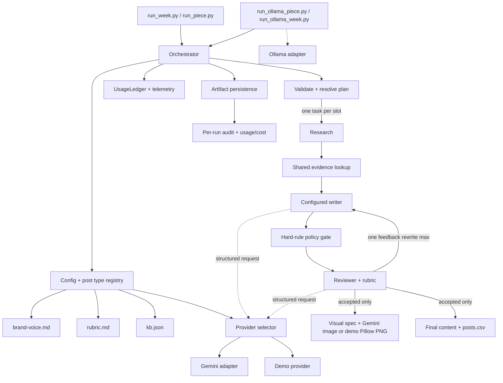

# Architecture

The pipeline keeps deterministic policy and evidence checks outside model judgment. The orchestrator validates all inputs, resolves the six-slot plan, then runs each slot independently under a bounded semaphore. Research and review share the evidence lookup skill, so both use the same source IDs and fact text. Writer prompt placeholders are rendered from the selected topic and post-type limits before each request; a revision receives both reviewer feedback and the rejected draft.

A slot's state is explicit: `planned -> researched -> drafted -> reviewed -> revised? -> accepted|dropped|failed`. `asyncio.gather(return_exceptions=True)` and per-slot artifacts isolate a broken source or provider call. The visual stage receives only final accepted content; if visual or image generation is unavailable, the grounded visual spec remains available and the configured Pillow fallback can render locally. Model prompts are files, while Pydantic contracts validate their JSON responses.

## Provider layer

Live model calls use Google Gemini. `GEMINI_API_KEY` and `GEMINI_MODEL` configure the provider; optional per-agent model overrides (`GEMINI_RESEARCH_MODEL`, `GEMINI_REVIEW_MODEL`, `GEMINI_WRITER_MODEL`, `GEMINI_VISUAL_MODEL`) are applied to research, writers, reviewer, and visual-spec requests through the provider's `agent_models` map. The same Gemini client/key serves agents when no override is configured, while each agent keeps its own system instructions and response schema. The adapter separates system instructions from user context, asks Gemini for structured JSON, validates the result with the existing Pydantic model, and records every returned attempt's usage metadata in the shared `UsageLedger`. Missing usage or pricing remains explicitly unknown.

The `DemoProvider` is a deterministic offline provider that returns fixture data for every response model without making any network call. It reports zero tokens and zero cost. It is used by demo mode and tests.

The `OllamaAdapter` (defined in `run_ollama_piece.py`, reused by `run_ollama_week.py`) is a process-local adapter that routes all agent requests to a local Ollama server. It normalizes small-model quirks such as percentage-range rubric scores and criterion ID aliases, retries up to three times with linear backoff, and forces Pillow image fallback. It preserves the verified KB research packet when the model returns a ResearchPacket response, preventing local models from rewriting source IDs. The Ollama adapter is never imported by the core `content_pipeline` package.

## Retry and error handling

The Gemini provider adapter applies bounded exponential backoff with jitter to transient failures such as `429`, `503`, `408`, `500`, `502`, `504`, and timeouts. Permanent quota exhaustion, billing denials, and authentication errors fail immediately. Empty, blocked, invalid, or otherwise unusable responses become slot-level failures after the bounded transport attempts. This retry budget is independent from the orchestrator's single content rewrite after reviewer rejection. `MAX_CONCURRENT_REQUESTS` and the CLI concurrency bound limit simultaneous provider work through an `asyncio.Semaphore`; `asyncio.gather(return_exceptions=True)` preserves fault isolation across slots.

Provider errors are redacted to remove API keys and bounded to 1000 characters for safe audit logging.

## Telemetry

The `UsageLedger` collects a `UsageRecord` for every provider request, including retried and failed attempts. Each record stores agent name, slot ID, attempt number, model, input/output/cached/total/thinking/tool tokens, and cost. The ledger computes known subtotals and reports incomplete data as explicit unknowns rather than fabricating zeros. The `record_provider_usage` helper normalizes both successful responses and provider exceptions into usage records, supporting `request_usages` lists for multi-attempt calls.

## Reviewer gate

The reviewer combines model judgment with deterministic policy. In live mode, Gemini scores each rubric criterion, but Python recomputes the weighted average from the configured rubric weights, enforces per-criterion minimums, and applies non-overridable grounding and hard-rule gates. A model's boolean `approved` flag is not trusted; approval is derived from the validated score, grounding result, and Python policy gates. Missing criteria trigger rejection. The model's reasons remain available in the audit.

## Scaling rationale

The current weekly validator intentionally requires exactly six slots: three technical threads and three marketing posts. The semaphore is independent of that shape, but supporting a 15-slot week requires relaxing the weekly shape validator and adding explicit plan-specific count rules. Research evidence is immutable and can be cached by KB ID/fingerprint; provider calls can later use a queue with per-model rate limits. A second platform should add a post type/export adapter while retaining the same `ResearchPacket`, evidence IDs, review result, hard rules, and visual spec. Platform-specific length and media rules belong in that adapter, not in research.

The CSV deliberately stays scheduler-friendly: `Post Text,Image` only. Thread IDs, tweet order, source maps, attempt history, and model usage remain in JSON artifacts. A scheduler requiring hosted media URLs must upload the run-relative PNGs/JPEGs after export.
